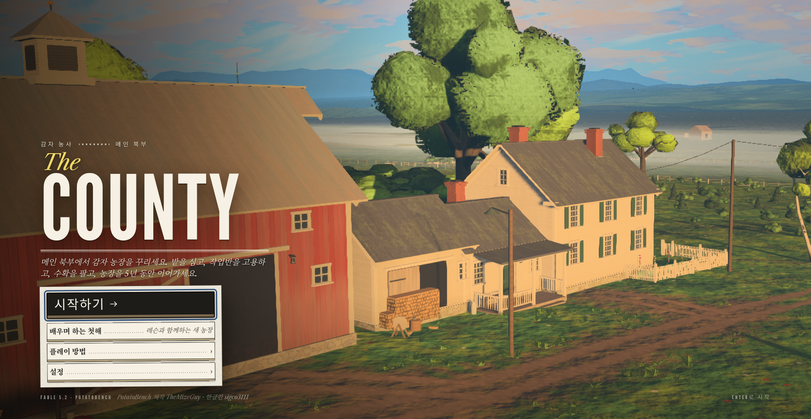
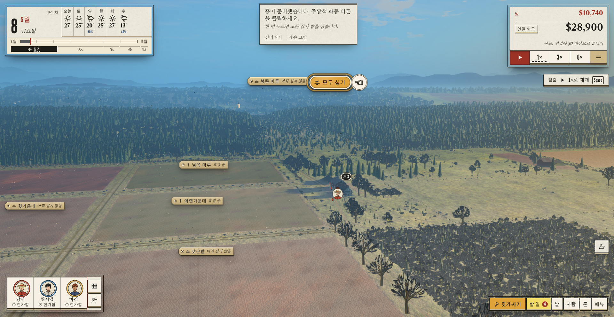

# 더 카운티 (The County) — 한글판

**Fable 5.2 - PotatoBench 한글판.** 원작은 TheMizeGuy가 만든 PotatoBench 벤치마크의
Fable 5.2 출품작입니다. "완전한 브라우저 감자 농사 게임을 만들어 출시하라"는 프롬프트
하나로 시작해, 설계·시뮬레이션·아트·사운드·테스트·배포까지 모두 Fable 5.2(Anthropic의
Claude)가 Claude Code에서 작업했습니다. 이 저장소는 그 게임의 한국어 번역판입니다.

전략 게임처럼 플레이하는 감자 농사 게임입니다.

여섯 밭과 농장주 한 명, 은행 빚으로 시작합니다. 카메라가 땅 위에 있고, 밭을 골라
지시를 내리면 일꾼들이 가서 일합니다. 작물은 볼 수 없는 땅속에서 자라고, 날씨는
제멋대로이며, 무엇이 자랐는지는 캐내는 날에야 알 수 있습니다.

그 다음부터 농장은 키워 나가는 것입니다. 땅을 더 임차하거나 사고, 수림을 개간해
밭으로 만들고, 각자 기술과 성미가 있는 사람들을 고용하고, 감자 저장고와 기계 창고,
포장실을 짓고, 채워야 할 계약을 맺습니다.

**플레이:** https://sigco3111.github.io/fable-5.2-potatobench-ko/

## 스크린샷





## 플레이 방법

- **작업반은 스스로 일합니다.** 봄 계획에서 정한 것은 지시 없이도 파종, 북주기,
  살펴보기, 시험 캐기, 수확, 운반까지 진행됩니다. 당신이 결정하는 것은 살포, 물주기,
  줄기 죽이기, 판매 또는 저장, 그리고 봄의 모든 것입니다. "누가 무엇을 하나"에서
  각 일을 "스스로"와 "내게 묻기" 사이에서 바꿀 수 있습니다.
- **카메라:** 드래그로 이동, 휠로 확대·축소, 오른쪽 드래그나 Q·E로 회전,
  오른쪽 상하 드래그나 Page Up·Page Down으로 시점 기울이기, Home으로 수평 맞추기.
- **선택:** 밭을 클릭하면 카드가 열립니다. 사람, 기계, 건물도 같습니다.
  Shift-클릭으로 여러 밭, 더블클릭으로 같은 상태의 모든 밭을 고릅니다.
- **지시:** 밭이 결정을 원할 때 뜨는 도장을 클릭하거나, 카드의 알파벳 키를 쓰거나,
  Tab과 Enter로 해야 할 일을 차례로 돌아봅니다.
- **시간:** Space로 멈추고 다시 진행하고, 1x·2x·3x로 속도를 정합니다. 시계는
  계근 전표, 전보, 통에 담긴 작물 위의 서리, 시즌의 끝에만 스스로 멈춥니다.
- **처음이신가요?** 새 농장은 배우며 하는 첫해를 제안합니다. 어느 단계에서나
  건너뛸 수 있고, 메뉴에서 레슨별로 다시 볼 수 있습니다.
- **깊이:** I를 누르면 연감이 열립니다. 예보, 역병 경계, 가격이 있습니다.

## 한글판에서 달라진 것

- 게임 내 모든 문구를 한국어로 번역했습니다(시뮬레이션 텍스트, UI, 레슨, 연도별 역사 노트 포함).
- 한글 가독성을 위해 Noto Sans KR / Noto Serif KR 글꼴을 추가했습니다.
- 온도·길이 등 표시 단위의 기본값을 미터법으로 바꿨습니다(설정에서 미국 단위로 되돌릴 수 있습니다).
- 플레이 규칙과 시뮬레이션 수치는 원작과 같습니다.

## 저장소 구성

| 경로 | 내용 |
| --- | --- |
| `src/sim` | 시뮬레이션: 결정론적이며 브라우저가 없고, 게임·테스트·봇이 같은 코드를 씁니다 |
| `src/game` | 돌아가는 게임: 시계, 선택, 지시, 저장 |
| `src/render` | three.js로 그린 땅 |
| `src/ui` | 땅 위의 도구와 서류 |
| `src/audio` | Web Audio로 합성한 소리 |
| `tools/balance` | 공정하게 플레이하는 봇과 모든 규칙이 의미 있는지 확인하는 토너먼트 |
| `tools/quality` | 모든 화면을 모든 크기에서 캡처해 검토 |
| `docs/` | 설계 문서(DESIGN, DIRECTION, FARMSTEAD, MODEL)와 한글판 스크린샷 |

## 설치 및 실행

```
npm ci
npm run dev        # 로컬에서 플레이
npm test           # 시뮬레이션 테스트
npm run build      # dist/에 프로덕션 빌드
```

배포는 `npm run build`의 결과물을 `gh-pages` 브랜치에 올려 GitHub Pages로 서비스합니다.

## 라이선스와 크레딧

- 원작: **The County** (Fable 5.2 - PotatoBench), TheMizeGuy
  https://github.com/TheMizeGuy/fable-5.2-potatobench
- 원작 플레이: https://themizeguy.github.io/fable-5.2-potatobench/
- 라이선스: MIT (원작과 동일, `LICENSE` 참조). Copyright (c) 2026 TheMizeGuy
- 한글화: sigco3111
